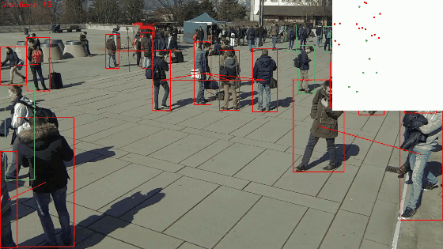
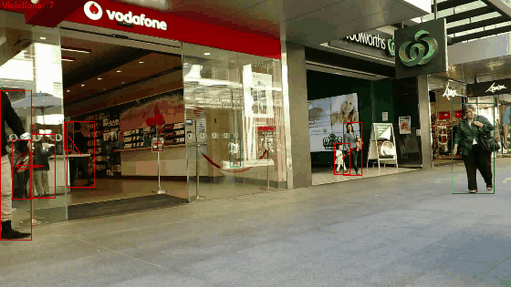
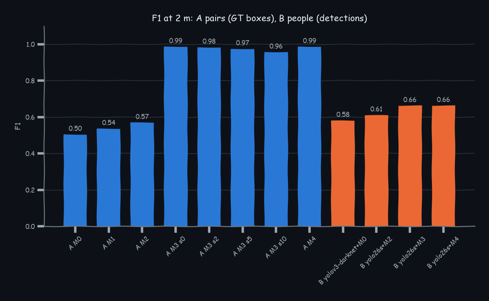
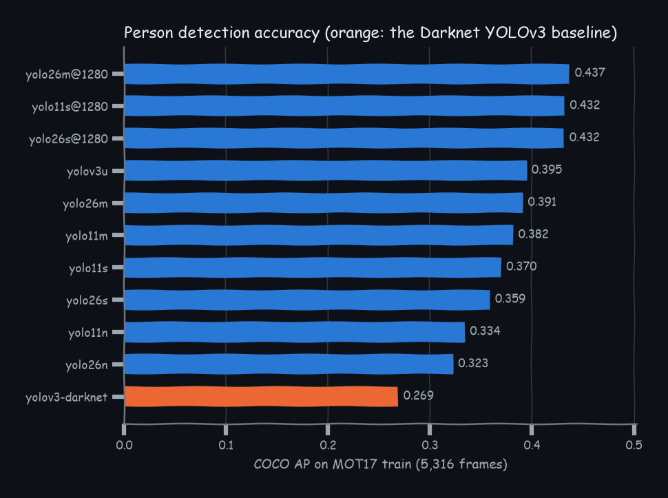
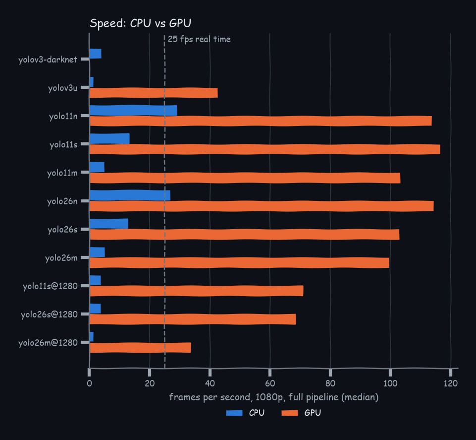

# Social Distance Analyzer

- COVID-19 social distancing checker.
- Flags people closer than 2 m.
- Measured from each person's feet on the floor, with no depth sensor or second camera.
- Setup: Open the camera view &rarr; click 4 floor points whose spacing is known &rarr; done!
- 11 YOLO detectors benchmarked.

<table>
<tr>
<td width="50%"></td>
<td width="50%"></td>
</tr>
<tr>
<td>WILDTRACK C1, calibrated: pairs closer than 2 m in red, bird's-eye view top right.</td>
<td>MOT17-09, uncalibrated: BoT-SORT ids and the pixel rule (50 px at 700 px width).</td>
</tr>
</table>

## Context

- The usual shortcut is a pixel rule: YOLOv3 through OpenCV, box centres, and two people
  flagged when their centres are closer than 50 pixels at 700 px frame width. `sda/detect.py`
  keeps that detector as the baseline.
- A pixel distance depends on where people stand: 60 px near the camera can be 1 m, 60 px at the
  far end of the frame can be 6 m.
- On WILDTRACK, where every person has a measured ground position, the pixel rule agrees with the
  2 m truth on half of the pairs (pair F1 0.50). Any pixel threshold does about the same
  (0.54 to 0.57 after tuning per camera).
- This project projects feet to the ground plane and measures in metres, keeps the pixel-rule baseline
  runnable, and reports both on two public datasets.

## Pipeline

1. Detect people with any Ultralytics model (`yolo26s`, `yolo11m@1280`, a fine-tuned `.pt`) or
   the Darknet YOLOv3 through `cv2.dnn`, on GPU or CPU.
2. Take the bottom centre of each box as the point where the person stands.
3. Project those points to the ground plane through a homography fitted once from four clicked
   floor points with known spacing (`python -m sda calibrate`).
4. Flag every pair closer than the threshold in metres; draw boxes, pair lines, a bird's-eye inset,
   and ByteTrack or BoT-SORT ids when tracking is on.

## Results

Full tables and figures are in [RESULTS.md](RESULTS.md).

| question | pixel rule (YOLOv3, 50 px) | this version |
|---|---|---|
| Does "closer than 50 px" mean "closer than 2 m"? (WILDTRACK, ground-truth boxes, pair F1) | 0.50 | 0.99 from four clicked floor points (0.96 with 10 px click noise); distance error 4.2 cm MAE |
| End to end, who is flagged correctly? (WILDTRACK, detector boxes, person F1 / precision) | 0.58 / 0.84 | 0.66 / 0.96; recall is 0.44 to 0.51 for both because detection misses people, the geometry itself scores 0.99 on ground-truth boxes |
| Detector accuracy in crowds (MOT17, COCO AP / F1 at the app threshold) | 0.27 / 0.61 (YOLOv3, 416 px) | 0.44 / 0.73 (YOLO26m, 1280 px). At 640 px every newer model has a higher AP and a lower F1 at the baseline's threshold (0.51 to 0.59 against 0.61). With the threshold tuned, the s and m models reach 0.62 to 0.66 against the baseline's 0.63; the nano models stay below it |
| Tracking (MOT17, HOTA) | none | 0.49 (YOLO26s 1280 px, conf 0.1, BoT-SORT); ByteTrack 0.46 |
| Does fine-tuning on crowd footage help? (held-out MOT17 sequences) | n/a | No; it hurts. yolo26s trained 15 epochs on four MOT17 scenes scores AP 0.33 against 0.36 zero-shot on the three held-out scenes, while its same-scene validation mAP rose from 0.66 to 0.72 (scene overfitting) |
| Speed (1080p, full pipeline, median) | 4 fps, CPU | CPU: 27 fps (yolo26n, 640 px), 3.9 fps (yolo26s, 1280 px). RTX 4060 laptop GPU: 100 to 117 fps at 640 px for the YOLO11/26 models, 69 fps (yolo26s) and 34 fps (yolo26m) at 1280 px |







## Quickstart

```bash
uv venv --python 3.12 .venv && uv pip install -e . --group dev
uv pip install torch --index-url https://download.pytorch.org/whl/cu128   # GPU build; PyPI ships CPU-only wheels on Windows
python -m sda calibrate video.mp4 --ground "0,0;4,0;4,4;0,4" --out calib.json   # click four floor points once
python -m sda run video.mp4 --model yolo26s --calib calib.json --threshold 2.0 --track --out out.mp4
python -m sda run video.mp4 --model yolov3-darknet --pixel-threshold 50 --pixel-width 700   # the pixel rule
```

Weights download on first use into `data/models/`. The Darknet baseline needs `yolov3.cfg`,
`yolov3.weights` and `coco.names` from the Darknet site in that folder. `--pixel-width 700`
scales the pixel threshold to the input width, because the 50 px rule is defined on frames resized to
700 px. For the benchmarked tracking quality use
`--model yolo26s@1280 --conf 0.1 --track --tracker botsort.yaml`; the trackers use low-confidence
boxes in their second association pass.

`docs/calibration_wildtrack_c1.json` is a calibration file in the format `sda calibrate` writes,
derived from WILDTRACK's camera model; `scripts/make_demo.py` rebuilds the media above from it.

## Evaluation

```bash
bash scripts/run_benchmarks.sh      # every benchmark, one at a time; needs the datasets below
python -m evaluation.report         # RESULTS.md and the detection/speed figures from results/*.json
```

The WILDTRACK figures are drawn by `python -m evaluation.wildtrack --fig-dir results/figures`.
Each benchmark caches its raw predictions, tagged with its settings (model, image size,
confidence, box cap), so a rerun after a crash redoes only unfinished work. Jobs run one at a time on the GPU under a VRAM cap
(`scripts/capped.py`); training runs alone.

What is measured:

- Detection: COCO AP and the operating point at confidence 0.3, IoU 0.5, on all 5,316 MOT17 train
  frames, eleven detectors, plus a confidence sweep and recall by occlusion level.
- Tracking: HOTA, MOTA and IDF1 through TrackEval, ByteTrack and BoT-SORT, five detector settings.
- Distance: on WILDTRACK, pair and person F1 at 2 m for the pixel rule, per-camera tuned pixel
  thresholds, the four-click homography (20 noise seeds at each of 0, 2, 5, 10 px) and the full
  calibration; distance error by range; end to end with detector boxes.
- Fine-tuning: yolo26s on four MOT17 scenes, scored on the other three.
- Speed: median per-frame latency of the full pipeline on 1080p, CPU and GPU.

## Caveats

- MOT17 test annotations are not public, so every MOT17 number is on the train split; the
  fine-tuning experiment is split by sequence and scored on held-out sequences, the per-model tuned
  confidence is chosen on the scored frames.
- Boxes are clipped to the frame for every detector and for the ground truth (MOT17 annotates
  bodies that leave the image); the Darknet baseline's YOLO layer threshold is lowered so
  `cv2.dnn` does not cut its precision-recall curve at 0.2.
- WILDTRACK annotations are not exhaustive and its boxes come from a model, so end-to-end
  precision is scored on detections matched to annotated people and unmatched flags are counted
  separately.
- Ultralytics trackers assume 30 fps for in-memory frames (MOT17-05 is 14 fps, MOT17-13 is 25);
  speed numbers come from one laptop (RTX 4060, i9-13900H).

## Data and redistribution

- `data/MOT17/train/*-FRCNN/` from [motchallenge.net](https://motchallenge.net/data/MOT17/)
  (Milan et al., 2016; CC BY-NC-SA 3.0).
- `data/Wildtrack/` from the [EPFL CVLab WILDTRACK page](https://www.epfl.ch/labs/cvlab/data/data-wildtrack/)
  (Chavdarova et al., CVPR 2018; research use). The archive is a macOS zip64 whose local header
  offsets are off by 2^32; `zipfile` needs them corrected.

Neither dataset is redistributed here. The GIFs and stills in `docs/` are a few annotated frames
from each, shown under the dataset terms with attribution. Git ignores the datasets, weights, prediction
caches and videos.
