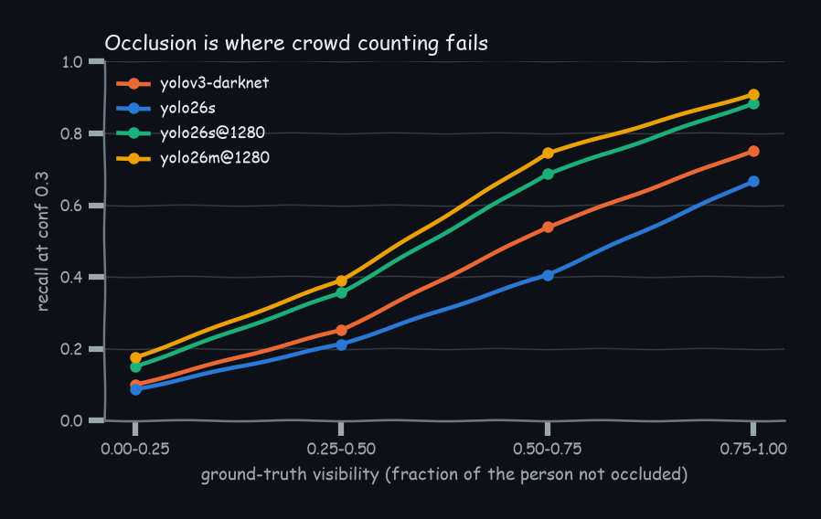
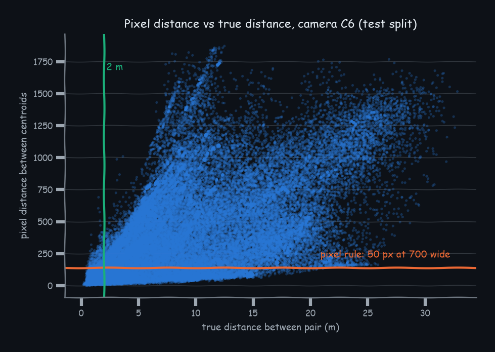
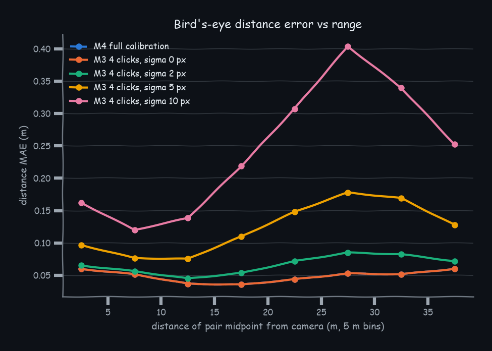

# Results

Generated by `python -m evaluation.report` from `results/*.json`; reproduce with `bash scripts/run_benchmarks.sh`. Headline findings are in README.md.

## 1. Detection accuracy (MOT17)

7 sequences, 5316 frames. Positives: class 1 (pedestrian) with flag 1, clipped to the frame (MOT17 annotates bodies that leave the image; every detector's boxes are clipped the same way). Ignore regions: pycocotools iscrowd regions: a detection whose intersection over its own area with an ignore box reaches the IoU threshold is neither TP nor FP; other classes are dropped. Operating point: the app's confidence 0.3 at IoU 0.5, chosen for the Darknet baseline's score scale; `best conf` is each model's F1-maximising threshold on a 0.05 grid (same matching, so optimistic by one tuning step). Inference size 640 unless the name ends in `@1280`.

| detector | AP | AP50 | P@0.3 | R@0.3 | F1@0.3 | best conf | R@best | F1@best |
|---|---|---|---|---|---|---|---|---|
| yolo26m@1280 | 0.437 | 0.741 | 0.878 | 0.620 | 0.727 | 0.20 | 0.664 | 0.736 |
| yolo11s@1280 | 0.432 | 0.734 | 0.885 | 0.595 | 0.711 | 0.20 | 0.647 | 0.722 |
| yolo26s@1280 | 0.432 | 0.732 | 0.885 | 0.588 | 0.707 | 0.20 | 0.635 | 0.720 |
| yolov3u | 0.395 | 0.669 | 0.929 | 0.436 | 0.594 | 0.10 | 0.560 | 0.663 |
| yolo26m | 0.391 | 0.667 | 0.926 | 0.415 | 0.573 | 0.05 | 0.633 | 0.660 |
| yolo11m | 0.382 | 0.650 | 0.928 | 0.409 | 0.567 | 0.05 | 0.607 | 0.644 |
| yolo11s | 0.370 | 0.639 | 0.919 | 0.418 | 0.575 | 0.10 | 0.558 | 0.637 |
| yolo26s | 0.359 | 0.619 | 0.922 | 0.410 | 0.567 | 0.10 | 0.530 | 0.623 |
| yolo11n | 0.334 | 0.590 | 0.924 | 0.379 | 0.538 | 0.10 | 0.506 | 0.589 |
| yolo26n | 0.323 | 0.576 | 0.937 | 0.345 | 0.505 | 0.10 | 0.477 | 0.576 |
| yolov3-darknet | 0.269 | 0.566 | 0.861 | 0.478 | 0.614 | 0.15 | 0.531 | 0.628 |

## 2. Tracking (MOT17, TrackEval)

Ultralytics trackers at detector conf 0.1; MOTChallenge preprocessing (distractor matches removed). Ultralytics assumes 30 fps for in-memory frames (MOT17-05 is 14 fps, MOT17-13 is 25 fps); this affects every row alike. fps is detection + tracking wall time on the RTX 4060 Laptop GPU while other benchmark jobs shared it, so compare rows only loosely; section 4 has clean speed numbers.

| detector | tracker | HOTA | DetA | AssA | MOTA | IDF1 | IDSW | fps |
|---|---|---|---|---|---|---|---|---|
| yolo26s@1280 | botsort | 0.485 | 0.477 | 0.498 | 0.515 | 0.570 | 621 | 26.1 |
| yolo26s@1280 | bytetrack | 0.460 | 0.464 | 0.461 | 0.505 | 0.538 | 851 | 43.7 |
| yolo26m | botsort | 0.434 | 0.372 | 0.511 | 0.411 | 0.505 | 380 | 31.0 |
| yolo11s | botsort | 0.427 | 0.369 | 0.499 | 0.406 | 0.498 | 377 | 12.6 |
| yolo26s | botsort | 0.424 | 0.358 | 0.507 | 0.396 | 0.488 | 402 | 32.2 |
| yolo26m | bytetrack | 0.417 | 0.358 | 0.489 | 0.401 | 0.490 | 506 | 55.0 |
| yolo11s | bytetrack | 0.406 | 0.358 | 0.464 | 0.397 | 0.472 | 543 | 15.3 |
| yolo26s | bytetrack | 0.398 | 0.344 | 0.464 | 0.384 | 0.459 | 538 | 63.4 |
| yolo26n | botsort | 0.388 | 0.307 | 0.495 | 0.344 | 0.435 | 351 | 28.0 |
| yolo26n | bytetrack | 0.361 | 0.296 | 0.445 | 0.334 | 0.403 | 466 | 30.2 |

## 3. Real-world distance accuracy (WILDTRACK)

7 calibrated cameras; ground-truth positions on a 2.5 cm grid. Thresholds tuned on frames 0-995, every number below on frames 1000-1995. Calibration check: median reprojection error of GT positions onto GT box feet, px: C1 6.8, C2 5.2, C3 8.7, C4 8.1, C5 9.0, C6 2.4, C7 11.1.

### Phase A: ground-truth boxes (geometry only), violation = closer than 2.0 m

| id | method | pair F1 | person F1 |
|---|---|---|---|
| M0 | pixel rule: centroid pixels, 50 px at 700 px width | 0.505 | 0.878 |
| M1 | centroid pixels, threshold tuned per camera | 0.536 | 0.885 |
| M2 | feet pixels, threshold tuned per camera | 0.569 | 0.886 |
| M3 σ=0px | bird's-eye from 4 clicked floor points, σ=0 px | 0.987 ± 0.000 | 0.994 ± 0.000 |
| M3 σ=2px | bird's-eye from 4 clicked floor points, σ=2 px | 0.984 ± 0.002 | 0.992 ± 0.001 |
| M3 σ=5px | bird's-eye from 4 clicked floor points, σ=5 px | 0.975 ± 0.006 | 0.988 ± 0.002 |
| M3 σ=10px | bird's-eye from 4 clicked floor points, σ=10 px | 0.957 ± 0.013 | 0.981 ± 0.006 |
| M4 | bird's-eye, full calibration (upper bound) | 0.987 | 0.994 |

Bird's-eye (M4) distance error over GT pairs closer than 5 m: MAE 0.042 m, median 0.035 m, P90 0.085 m; by distance from camera: 0-5 m: 0.060, 5-10 m: 0.051, 10-15 m: 0.037, 15-20 m: 0.035, 20-25 m: 0.044, 25-30 m: 0.053, 30-35 m: 0.052, 35-40 m: 0.060. Person position error median 0.082 m. 389 people whose box is cut by the frame bottom are excluded from these error statistics (their foot point is not in the image).

### Phase B: end to end with detector boxes, person-level, 2 m

Only detections matched (IoU ≥ 0.5) to annotated people are scored: WILDTRACK does not annotate everyone in view, so flagged unmatched detections are reported as unverifiable instead of as false positives. WILDTRACK boxes come from a person model, with no tight annotation, so IoU matching lowers recall equally for every row. Count MAE compares flagged matched detections with the true violator count per view; the all-flags column also counts the unverifiable flags, as a deployed counter would.

| detector + method | precision | recall | F1 | violator count MAE | count MAE, all flags | unverifiable flags |
|---|---|---|---|---|---|---|
| yolov3-darknet+M0 | 0.837 | 0.445 | 0.581 | 5.70 | 4.28 | 3957 |
| yolo26s+M2 | 0.852 | 0.477 | 0.611 | 5.76 | 5.89 | 1985 |
| yolo26s+M3 | 0.961 ± 0.001 | 0.506 ± 0.001 | 0.663 ± 0.001 | 5.77 ± 0.01 | 5.80 ± 0.01 | 1888 ± 7 |
| yolo26s+M4 | 0.961 | 0.506 | 0.663 | 5.76 | 5.79 | 1888 |

## 4. Speed

13th Gen Intel(R) Core(TM) i9-13900H / NVIDIA GeForce RTX 4060 Laptop GPU; torch 2.11.0+cu128, ultralytics 8.4.172, OpenCV 4.14.0. Median per-frame latency of detection + foot points + ground projection + pair check on MOT17-04 (1920x1080), after warm-up. The Darknet baseline is CPU only (pip OpenCV has no CUDA).

| detector | CPU fps | GPU fps |
|---|---|---|
| yolov3-darknet | 4.1 | n/a |
| yolov3u | 1.5 | 42.8 |
| yolo11n | 29.1 | 113.8 |
| yolo11s | 13.3 | 116.6 |
| yolo11m | 5.0 | 103.2 |
| yolo26n | 26.9 | 114.5 |
| yolo26s | 12.7 | 102.8 |
| yolo26m | 5.2 | 99.6 |
| yolo11s@1280 | 3.9 | 71.1 |
| yolo26s@1280 | 3.9 | 68.5 |
| yolo26m@1280 | 1.4 | 33.7 |

## 5. Fine-tuning vs zero-shot (held-out sequences)

yolo26s at 1280 px. Trained on MOT17-04-FRCNN, MOT17-10-FRCNN, MOT17-11-FRCNN, MOT17-13-FRCNN (15 epochs, batch 4, 84 min across 3 segments); evaluated on MOT17-02-FRCNN, MOT17-05-FRCNN, MOT17-09-FRCNN, never seen in training, model selection or threshold choice. The best threshold is chosen on the training sequences' held-out tail. Val mAP50-95 by epoch: 0.665, 0.678, 0.665, 0.678, 0.694, 0.702, 0.694, 0.698, 0.704, 0.710, 0.711, 0.712, 0.717, 0.720, 0.719.

| model | AP | AP50 | F1@0.3 | best conf (val) | F1@best | HOTA | MOTA | IDF1 |
|---|---|---|---|---|---|---|---|---|
| zero-shot (COCO) | 0.355 | 0.647 | 0.661 | 0.15 | 0.655 | 0.379 | 0.418 | 0.470 |
| fine-tuned on MOT17 | 0.334 | 0.546 | 0.576 | 0.35 | 0.570 | 0.351 | 0.365 | 0.417 |
